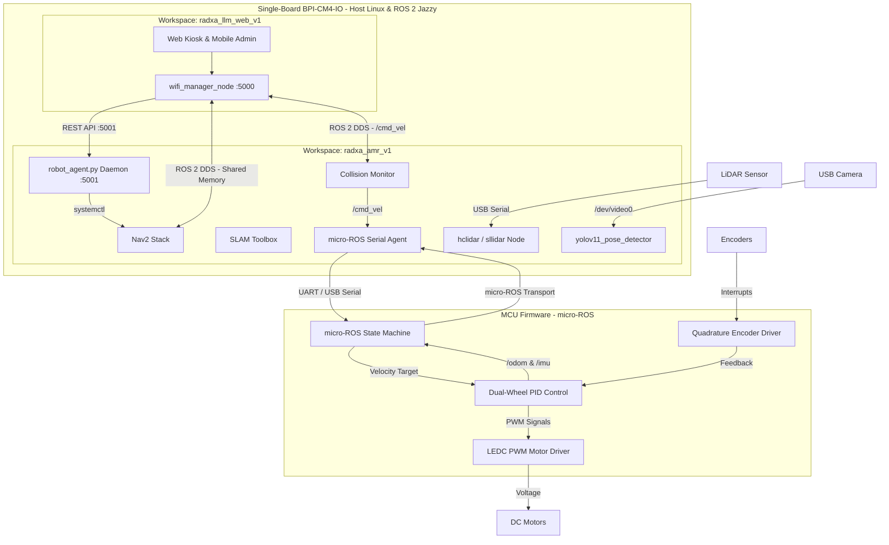

# Receptionist Robot Workspace Overview (GEMINI.md)

Welcome to the **Receptionist Robot** project workspace. This workspace contains the ROS 2 Jazzy host packages (running on the Single-Board **Banana Pi BPI-CM4-IO / bananapicm4io**) and is integrated with low-level ESP32-S3 motor control firmware.

---

## 1. System Architecture (Single-Board All-In-One)

The robot employs an **All-In-One Single-Board architecture** on the Banana Pi BPI-CM4-IO (`bananapicm4io` - Armbian 24.04 noble, ROS 2 Jazzy, user `rctrobot`):
1. **Robot Motion & Navigation Core (`radxa_amr_v1`):** Runs ROS 2 Jazzy, handles SLAM mapping (SLAM Toolbox), path planning (Nav2), LiDAR scanning (HCLiDAR / Camsense or RPLidar), safety monitoring (Collision Monitor), and computer vision (YOLOv11 Pose).
2. **Web Kiosk & Gateway (`radxa_llm_web_v1`):** Runs on the same board, providing local Kiosk UI, Web Mobile Admin Controller, WebSocket handling, and CCCD/NFC reader.
3. **Local Inter-Process Communication (No Ethernet required):**
   * **ROS 2 DDS:** Communicates natively across workspaces via **Shared Memory (SHM)** and `localhost / 127.0.0.1` (< 0.1ms latency).
   * **REST Control Gateway:** Web Gateway talks directly to `scripts/robot_agent.py` on `http://127.0.0.1:5001`.
4. **Low-Level Control (ESP32-S3):** Runs native C/C++ firmware (ESP-IDF v5.x) with micro-ROS, interfacing directly with motor driver hardware, reading quadrature encoders, and running real-time PID wheel velocity control loops.



---

## 2. Topic & Frame Routing

| Topic | Message Type | Publisher | Subscriber | Description |
| :--- | :--- | :--- | :--- | :--- |
| `/cmd_vel` | `geometry_msgs/msg/TwistStamped` | Collision Monitor / Teleop / Web | ESP32-S3 | Final safe movement commands. |
| `/cmd_vel_nav` | `geometry_msgs/msg/TwistStamped` | Nav2 Controller | ESP32-S3 | Autonomous navigation commands. |
| `/cmd_vel_smoothed`| `geometry_msgs/msg/Twist` | Velocity Smoother | Collision Monitor | Smoothed output from Nav2. |
| `/odom` | `nav_msgs/msg/Odometry` | ESP32-S3 | EKF Node / Nav2 | Raw dual-wheel encoder odometry. |
| `/imu` | `sensor_msgs/msg/Imu` | ESP32-S3 | EKF Node | Raw IMU orientation & angular velocity. |
| `/odometry/filtered`| `nav_msgs/msg/Odometry` | EKF Node | Nav2 / SLAM | Sensor-fused odometry output. |
| `/tf` | `tf2_msgs/msg/TFMessage` | EKF Node / Robot State Pub | TF Tree | Coordinate transformations ($odom \rightarrow base\_link$, etc.). ESP32 does NOT publish TF. |
| `/scan` | `sensor_msgs/msg/LaserScan` | HCLiDAR Driver / RPLidar | SLAM / Nav2 | Laser range scans for obstacle avoidance. |
| `/goal_pose` | `geometry_msgs/msg/PoseStamped` | robot_agent.py / Web UI | Nav2 | Navigation goal target position. |
| `/image_raw` | `sensor_msgs/msg/Image` | usb_cam | Vision / Pose | Raw video stream from camera. |

---

## 3. Host Workspace Packages & Daemon (`src/` & `scripts/`)

### 📂 `receptionist_robot_bringup`
Contains the launch infrastructure and central configuration files:
* **`launch/bringup.launch.py`:** Main entrypoint that starts the micro-ROS agent, LiDAR driver, Robot State Publisher, SLAM Toolbox (mapping or localization mode), and Nav2.
* **`config/nav2_params.yaml`:** Configuration for costmaps, planner, and local controller.
  * *Global Planner:* `GridBased` (NavfnPlanner).
  * *Local Planner:* `FollowPath` (`dwb_core::DWBLocalPlanner`).
  * *Costmaps:* Configured with a `0.25m` robot radius. Global inflation is set to `0.6m`, local inflation is set to `0.3m`.
* **`config/slam_toolbox_params.yaml`:** Configuration for 2D LiDAR SLAM mapping and active localization.

### 📂 `receptionist_robot_description`
Contains physical modeling and visualization components:
* **`urdf/receptionist_robot.urdf.xacro`:** URDF definition of the robot physical structure, wheel placement, and sensor positions.
* **`rviz/receptionist_robot.rviz`:** Preconfigured RViz visualization profile.

### 📂 `hclidar_driver_ros2` & `sllidar_ros2`
LiDAR sensor drivers configured to publish on `/scan` relative to the `laser` coordinate frame.

### 📂 `yolov11_pose_detector` & `usb_cam`
* **`usb_cam`:** V4L2 video capture node publishing to `/image_raw`.
* **`yolov11_pose_detector`:** Deep learning person & pose detection utilizing ONNX Runtime (`yolo11n-pose.onnx`). Throttled to ~3 FPS with 2 ONNX threads on CPU to conserve CPU cores for Nav2 and Web Kiosk.

### 📂 `scripts/robot_agent.py` (Local REST Control Daemon - Port 5001)
Lightweight HTTP daemon listening on `127.0.0.1:5001`:
* `/api/robot/status`: Returns system mode, home pose, current map, and service status.
* `/api/robot/maps`: Scans `map/` directory and returns saved map metadata.
* `/api/robot/mode`: Switches between SLAM `mapping` and Nav2 `localization`, restarting `robot_bringup.service`.
* `/api/robot/save-map`: Calls SLAM Toolbox serialization and Nav2 map saver to save both `.posegraph` and `.yaml` formats.
* `/api/robot/home`: Records new Home position or commands Nav2 to return to Home.
* `/api/robot/bringup`: Controls `robot_bringup.service` (`start`, `stop`, `restart`).

---

## 4. Systemd Background Services

| Service Name | Executable | Description |
| :--- | :--- | :--- |
| `robot_agent.service` | `scripts/robot_agent.py` | Runs REST control daemon on `127.0.0.1:5001`. |
| `robot_bringup.service` | `start_robot_bringup.sh` | Headless bringup of micro-ROS, LiDAR, Nav2, SLAM, Camera, and YOLO. |

Installation command:
```bash
~/radxa_amr_v1/scripts/install_robot_services.sh
```

---

## 5. ESP32-S3 MCU Firmware Summary

* **Execution Rate:** **20Hz** (50ms cycles).
* **Topics & Frames:** Publishes `/odom` (raw wheel odometry) and `/imu`. Does NOT publish `/tf` ($odom \rightarrow base\_link$ transform is exclusively handled by `ekf_node` on host to prevent TF jitter).
* **Communication Lifecycle:**
  * Auto-recovers and reboots (`esp_restart()`) to re-handshake and synchronize encoder counts if the host micro-ROS agent restarts.
  * Embedded **watchdog** halts motors if no command is received on `/cmd_vel` or `/cmd_vel_nav` within **150ms**.
* **Motor Control Specs:**
  * Uses **LEDC** at **2kHz** with **8-bit** duty cycle resolution (`0-255`).
  * Left motor pins: ENA `4`, IN1 `5`, IN2 `6`. Right motor pins: ENB `8`, IN3 `10`, IN4 `9`.
  * Left encoders: `7` & `15`. Right encoders: `11` & `16`.
  * Physical parameters: Wheel diameter = `65mm`, Wheel base = `300mm`, PPR = `325.0f`.
* **Kinematics & Control:**
  * Dual independent wheel PID loops ($K_P=100.0f$, $K_I=80.0f$, $K_D=1.2f$) with feedforward control.
  * Static deadband compensation (`90/255` PWM offset) to overcome gearbox/motor starting resistance.
  * Clamps minimum angular command to `0.25` rad/s to prevent low-velocity turning stalls.
